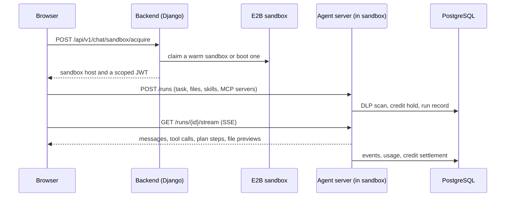

# Sukuna

Sukuna is the agent platform of Midsphere AI. A user hands it a task, and an agent does the work on its own cloud desktop: it writes and runs code, browses the web, builds web and mobile apps, and produces documents. The user watches every step live and can answer questions, redirect the agent, or open the files it made.

This repo is the whole product in one place: the Django backend, the SvelteKit web and desktop app, the agent server that runs inside each sandbox, and the deployment config.

| Package | What it is | Size |
|---|---|---|
| `packages/backend` | Django 5.1 and Django Ninja API with Celery, PostgreSQL and Redis | 9 apps, 267 HTTP endpoints, 73 models, 2,554 tests |
| `packages/frontend` | SvelteKit app on Svelte 5 and Tailwind 4, with a Tauri desktop shell | 38 pages, 159 components, 918 unit tests, 74 Playwright tests |
| `packages/sandbox` | Agent server built on [Exo](https://github.com/midsphere-ai/exo), running inside an E2B sandbox | 30 HTTP endpoints, 40 agent tools, 342 tests |

About 177,000 lines of code in total, 85,000 of them Python and 82,000 Svelte and TypeScript.

## How it works



The backend is hit once per session. It checks the user, finds or creates a sandbox, and returns the sandbox host with a JWT scoped to that conversation. From then on the browser talks to the agent server directly for runs, streaming, human-in-the-loop answers, files and MCP servers. Both services share one PostgreSQL database, so the agent server places and settles credit holds itself.

### The agent

- A planner agent takes the user's task and delegates work to executor agents it creates on the fly. Events from every agent flow into one SSE stream.
- A knowledge manager agent runs beside them. It writes what matters to files under `.sukuna/km/` in the workspace and feeds guidance back to the planner and executors.
- Context is reduced in two stages. Old tool calls are first swapped for compact versions that point at files on disk. When that stops helping, the full history is saved to disk and replaced with a summary.
- The 40 tools cover files, shell, search, a 15-tool Playwright browser, planning, git checkpoints, Next.js and Expo project management, image, audio and video perception, and messages to the user.
- MCP servers are called through a CLI so the model's tool list stays small and stable.
- Every run carries limits on runtime, tokens and cost. Each tool call is billed in credits as it happens.
- A run can also be started from Telegram or Slack.

### The backend

- `agents`: sandbox provisioning, a warm sandbox pool, JWT minting, presence, bring-your-own-model provider configs.
- `billing`: subscriptions through Dodo Payments, a credit wallet with holds, settlement and refunds, coupons, support tickets.
- `workspace`: organizations with role-based access, invitations, SSO, SCIM 2.0 provisioning, IP allowlists, conditional access, DLP policies, cost and model policies, org API keys, webhooks, notifications.
- `compliance`: immutable audit log, GDPR export and account deletion, consent records, retention policies, scheduled compliance exports, PII redaction in logs.
- `storage`: conversations, files, the skill catalog, user-authored skills, marketplace add-ons and MCP configs.
- `spaces`: projects with shared files, budgets and sharing.
- `users`: accounts, MFA, encrypted PII, developer API keys.
- `claw`: adapters for Telegram, Slack and Discord.
- `blogs`: blog and changelog.

### The frontend

A chat view with a side panel that shows what the agent is doing: views for the terminal, browser, diffs, search results, file trees, previews and the live desktop, plus a code editor. It also holds settings, billing, projects, skills, connectors, the organization and compliance admin, and a developer API reference. The same code builds as a web app, a PWA and a Tauri desktop app.

## Layout

```
packages/
  backend/     Django project: apps/, config/, tests/
  frontend/    SvelteKit app: src/lib, src/routes, src-tauri, tests/
  sandbox/     agent_server/, tools/, e2b/ (sandbox image), tests/
infra/
  compose/         Dockerfiles and start scripts for local and production
  digitalocean/    Terraform and Kubernetes config
  vault-config/    OpenBao config
docs/              billing and credits, BYOM, environment variables, local setup
```

The skill modules and project templates that the agent server loads are published with the standalone runtime, [sukuna-sandbox](https://github.com/midsphere-ai/sukuna-sandbox). The benchmark runs are at [sukuna-agent-benchmarks](https://github.com/midsphere-ai/sukuna-agent-benchmarks).

## Setup

Run the stack with Docker:

```bash
make dev-build
```

Or run each part by hand. `docs/local-setup.md` walks through a full local run with Ollama and no E2B account.

```bash
# agent server
cd packages/sandbox
cp .env.local.example .env.local
uv sync
LOCAL_MODE=1 uv run python -m agent_server

# backend
cd packages/backend
cp .env.example .env
uv sync
uv run manage.py migrate
uv run manage.py runserver

# frontend
cd packages/frontend
npm install
npm run dev
```

Tests:

```bash
cd packages/backend && uv run pytest
cd packages/sandbox && uv run pytest
cd packages/frontend && npm run test:unit
```

## Environment variables

In production the backend reads only `VAULT_ADDR` and `VAULT_TOKEN` from `.env` and loads everything else from OpenBao. The full list is in `docs/environment-variables.md`. The ones that matter most:

| Variable | Used by | Purpose |
|---|---|---|
| `VAULT_ADDR`, `VAULT_TOKEN` | backend, sandbox | OpenBao address and token |
| `PII_ENCRYPTION_KEY` | backend | Fernet key for encrypted user fields |
| `DATABASE_URL` | backend, sandbox | The shared PostgreSQL database |
| `SUKUNA_STREAM_JWT_SECRET` | backend, sandbox | Signs the session JWT the browser sends to the sandbox |
| `DODO_PAYMENTS_API_KEY`, `DODO_PAYMENTS_WEBHOOK_SECRET` | backend | Payments |
| `MANAGED_SUPER_LLM_PROVIDER`, `MANAGED_SUPER_LLM_MODEL`, `MANAGED_SUPER_LLM_BASE_URL`, `MANAGED_SUPER_LLM_API_KEY` | sandbox | The model the agents run on |
| `LOCAL_MODE` | sandbox | Set to `1` to skip OpenBao and read `.env.local` |

## Status

Midsphere AI wound down in 2026. This is published as it was and is not maintained.

## Licence

[MIT](LICENSE). Free to use, change, self-host and build on, including commercially.

Thanks to Exo, E2B, Django, Django Ninja, SvelteKit, Tauri, Playwright and cookiecutter-django.
